# Awesome-Vision-Language-Models-Multimodal-AI 🚀

  

  
  
  
  
  
  

---

## 🌟 Top Vision-Language Models & Multimodal AI Ecosystem

**Curated List of SaaS Products & Open-Source GitHub Projects**  
*Focused on Open-Weight Vision-Language Models (VLMs), Multimodal Document/Chart OCR, Visual Grounding, Multimodal Annotation & Edge VLM Runtimes*  
**Last updated: November 2026**

This repository (`Awesome-Vision-Language-Models-Multimodal-AI`) tracks notable **SaaS/Hosted platforms** and **open-source projects** for **Vision-Language Models & Multimodal AI** — Top Vision Language Models Multimodal AI (Opensource) 🌟 Star if you like it! 🌟. These tools power image-and-video reasoning, visual question answering (VQA), document/chart OCR, zero-shot object detection and visual grounding, multimodal dataset labeling, and edge/browser VLM inference.

**Examples** include Roboflow, Landing AI, Encord, Scale AI, Labelbox, V7 Labs, SuperAnnotate, Dataloop, Chooch, Clarifai, and `brandon-collins7/sketchvlm` (the category leaders).

**Open-source emphasis**: This section is heavily expanded with every major active project for open-weight Vision-Language foundation models (Qwen-VL, InternVL, Gemma 3, Llama Vision, Molmo, Florence-2, PaliGemma, SmolVLM, DeepSeek-VL), open-source multimodal labeling platforms, VLM serving engines, and standardized multimodal evaluation harnesses — ideal for computer vision engineers, AI researchers, robotics developers, and multimodal builders.

Contributions welcome! Open a PR to add/update entries. Keep descriptions factual and link to official sites.

---

## 📑 Table of Contents
- [Sector Overview & Market Dynamics](#-sector-overview--market-dynamics)
- [SaaS/Hosted Platforms](#-saashosted-platforms)
- [Open-Source GitHub Projects](#-open-source-github-projects)
- [How to Contribute](#-how-to-contribute)
- [Star History](#-star-history)
- [Support & Community](#-support--community)
- [Disclaimer](#-disclaimer)

---

## 📊 Sector Overview & Market Dynamics

The global Vision-Language Models (VLM) and Multimodal AI sector is estimated at **$4.2B to $4.8B in 2026** and projected to surpass **$35B–$50B by the mid-2030s**, compounding at an aggressive **CAGR of 26%–38%** across document intelligence, autonomous physical AI, and generative media.

Market structure exhibits a distinct **two-tier dynamic**: the foundation model infrastructure layer is **heavily concentrated** among an oligopoly of hyperscalers and frontier labs (Google, Meta, OpenAI, Microsoft, Alibaba) due to massive GPU compute barriers, while the downstream data annotation, domain-specific OCR, agentic vision workflows, and edge deployment tooling layer is **moderately fragmented** with specialized category leaders competing on multimodal ergonomics, latency, and compliance.

---

## 🏢 SaaS/Hosted Platforms

The following SaaS platforms provide hosted infrastructure, managed annotation pipelines, and multimodal model APIs. The table is ranked in descending order of company size (valuation / enterprise scale):

| Platform | Valuation / Size | Starting Pricing | Free Tier / Trial Limits | Description |
| :--- | :--- | :--- | :--- | :--- |
| **[Google Cloud Vertex AI & Gemini Multimodal](https://cloud.google.com/vertex-ai)** | **~$2.1T+** (Alphabet Market Cap) | Pay-as-you-go starting at **$0.075 per 1M input tokens** (Gemini Flash multimodal); free trial credit on GCP | **Google AI Studio Free Tier**: 15 RPM / 1,500 RPD free forever for multimodal prototyping; standard GCP accounts include **$300 credit for 90 days** | Enterprise hyperscaler platform serving native multimodal Gemini models with long-context video, audio, image reasoning, and custom adapter tuning. |
| **[Scale AI](https://scale.com)** | **$29 Billion** (Valuation, 2025/2026) | Scale Rapid pay-as-you-go starting at **$0.05 per unit**; managed enterprise data engine plans | **200 free labeling units per month** on Scale Rapid self-labeling; free academic tier on Nucleus dataset explorer | Enterprise AI data foundry and evaluation infrastructure powering multimodal RLHF, visual grounding, and frontier model red-teaming. |
| **[Labelbox](https://labelbox.com)** | **$1.3 Billion** (Valuation, Series E) | Starter plan pay-as-you-go at **$0.10 per LBU** (Labelbox Unit); custom Enterprise plans | **500 free LBUs per month** free forever (up to 30 users, 50 projects, and 10M data rows) | Cloud data-centric AI platform delivering model-assisted multimodal annotation, foundation model fine-tuning, and visual error diagnostics. |
| **[Clarifai](https://clarifai.com)** | **$775 Million** (Peak Series C Valuation) | Essential tier starting at **$30 per month** for 300,000 operations; custom Enterprise tier | **Community Free Plan**: 1,000 free operations & inputs per month free forever (1 application) | Pioneer deep learning orchestration platform offering hosted multimodal foundation models, visual search indexing, and automated labeling. |
| **[Encord](https://encord.com)** | **$550 Million** (Valuation, Series C) | Custom Starter plans (request quote) based on data volume tiers; custom Team/Enterprise | **14-day guided proof-of-concept trial** provisioned via sales demo with sandbox dataset evaluation limits | Multimodal AI data engine and active-learning platform for automated labeling, curation, and RLHF across images, video, and 3D point clouds. |
| **[Landing AI (LandingLens & ADE)](https://landing.ai)** | **~$350 Million** (Estimated Series A Valuation) | Pay-as-you-go at **$0.01 per credit**; monthly Team plans starting at **$250 per month** | **1,000 free credits per month** on LandingLens free plan (up to 10k images/project, 3 user invites); 1,000 free credits for 90 days on ADE APIs | Visual AI and multimodal document intelligence platform created by Andrew Ng's team for industrial inspection and agentic document parsing. |
| **[Roboflow](https://roboflow.com)** | **~$200 Million** (Estimated Series B Valuation) | Starter / Core credit packs starting at **$39 per month** (20 monthly credits); custom Enterprise | **Free Plan forever**: 10 monthly credits included (~30 training runs or ~80k cloud inferences) + unlimited free local self-hosted inference | End-to-end computer vision and multimodal platform providing automated dataset annotation, VLM workflow orchestration, and edge deployment. |
| **[V7 Labs (V7 Darwin & V7 Go)](https://v7labs.com)** | **~$150 Million** (Estimated Series A Valuation) | Starter platform configurations starting at **$499 per month** (or £150–$160/user/month); custom annual Enterprise | **Custom guided pilot / sandbox trial** upon demo consultation (scoped to dataset and modality requirements) | Automated visual annotation and multimodal AI agent platform combining Segment Anything auto-labeling with VLM-powered document workflows. |
| **[Dataloop](https://dataloop.ai)** | **$120 Million** (Acquired by Dell Technologies) | Enterprise custom quote pricing based on managed data items and compute resources | **Guided pilot / Proof of Concept (PoC) evaluation** arranged directly via technical sales consultation | Enterprise AI data management and visual pipeline platform integrating human-in-the-loop annotation with automated VLM inference. |
| **[SuperAnnotate](https://superannotate.com)** | **~$100 Million+** (Total Series B Funding: $50M) | Starter / Custom plans based on compute hours and team seats (quote-based) | **Starter Free Plan**: Free entry tier supporting up to 3 users, 5,000 managed items, and **1,000 compute hours** for pipeline orchestration | Enterprise multimodal data infrastructure and custom LLM/VLM evaluation suite supporting image, video, LiDAR, and agent trajectories. |
| **[Chooch](https://chooch.com)** | **~$35 Million+** (Total Venture Funding) | Enterprise quote based on active camera streams, connected edge devices, and processed FPS | **Free entry account**: Free access to web workbench layout and sample image/video testing tools | Enterprise edge-to-cloud computer vision and generative VLM platform delivering real-time video analytics, safety monitoring, and visual search. |

---

## 💻 Open-Source GitHub Projects

The following curated open-source projects cover foundational vision-language architectures, document OCR engines, visual grounding toolkits, data labeling suites, and high-throughput VLM serving runtimes. Repositories are sorted in **descending order by GitHub star count**, featuring live social star badges linking directly to their respective stargazers pages:

| Project | Stars | Focus & Category | Description |
| :--- | :---: | :--- | :--- |
| **[llama.cpp](https://github.com/ggml-org/llama.cpp)** |  | Edge & Local VLM Inference | Foundational C/C++ inference engine supporting GGUF quantized Vision-Language Models (`libmtmd`) across CPU, Apple Metal, CUDA, Vulkan, and mobile hardware. |
| **[vLLM](https://github.com/vllm-project/vllm)** |  | High-Throughput Serving Engine | High-throughput open-source inference and serving engine with native PagedAttention support for Qwen2.5-VL, InternVL, Llama Vision, Gemma 3, and Pixtral models. |
| **[PaddleOCR](https://github.com/PaddlePaddle/PaddleOCR)** |  | Multilingual OCR & Layout Analysis | Awesome multilingual OCR toolkits based on PaddlePaddle, supporting PP-OCRv4, table recognition, and document structure analysis across 80+ languages. |
| **[MinerU](https://github.com/opendatalab/MinerU)** |  | Multimodal Document Extraction | High-precision open-source PDF and academic document extractor converting complex scientific layouts, formulas, and tables into clean Markdown/JSON. |
| **[Docling](https://github.com/docling-project/docling)** |  | Multimodal Document Intelligence | Linux Foundation / IBM open-source multimodal document parser combining layout analysis, TableFormer, and VLM pipelines (`SmolDocling`) to turn PDFs into structured data. |
| **[Ultralytics YOLO](https://github.com/ultralytics/ultralytics)** |  | Real-Time Detection & Vision AI | Industry-standard computer vision framework for YOLOv8, YOLOv11, and multimodal zero-shot detection, instance segmentation, and pose tracking. |
| **[Supervision](https://github.com/roboflow/supervision)** |  | Computer Vision Utility Toolkit | Popular MIT-licensed Python toolkit by Roboflow for annotating, filtering, tracking, and visualizing outputs from VLMs, YOLO, GroundingDINO, and SAM2. |
| **[Marker](https://github.com/VikParuchuri/marker)** |  | PDF to Markdown Converter | Fast, highly accurate open-source deep learning pipeline converting PDF, EPUB, and MOBI books and papers into formatted Markdown with LaTeX math support. |
| **[SGLang](https://github.com/sgl-project/sglang)** |  | VLM Structured Serving Engine | Fast open-source serving runtime optimized for multi-turn multimodal workflows, RadixAttention image-token caching, and constrained JSON structured outputs. |
| **[GFPGAN](https://github.com/TencentARC/GFPGAN)** |  | Face Restoration & Super-Resolution | Practical face restoration algorithm for real-world low-quality images using facial component generative priors by Tencent ARC. |
| **[EasyOCR](https://github.com/JaidedAI/EasyOCR)** |  | Ready-to-use OCR Library | Ready-to-use Python OCR library based on PyTorch supporting 80+ languages and all popular scripts including Latin, Chinese, Arabic, Devanagari, and Cyrillic. |
| **[Label Studio](https://github.com/HumanSignal/label-studio)** |  | Multi-Modal Data Labeling | Industry-standard open-source multi-type data labeling and RLHF platform supporting image bounding boxes, polygons, video timelines, audio, and VLM backends. |
| **[MiniCPM-V](https://github.com/OpenBMB/MiniCPM-V)** |  | Efficient On-Device VLM | Efficiency-focused open-weight multimodal LLMs delivering GPT-4V-level OCR and multi-image/video understanding on consumer GPUs, laptops, and mobile devices. |
| **[LLaVA](https://github.com/haotian-liu/LLaVA)** |  | Visual Instruction Tuning | Pioneering open-source visual instruction-tuning framework connecting CLIP/SigLIP vision encoders with open LLMs across single-image, multi-image, and video tasks. |
| **[UniLM & LayoutLM](https://github.com/microsoft/unilm)** |  | Document Pre-Training & LayoutLM | Microsoft's large-scale cross-modal pre-trained foundation models including LayoutLMv1/v2/v3, DiT, and LayoutXLM for multimodal document intelligence. |
| **[Surya](https://github.com/VikParuchuri/surya)** |  | Multilingual OCR & Layout Analysis | Multilingual document OCR, layout analysis, reading order detection, and line-level text detection model supporting 90+ languages. |
| **[Qwen2.5-VL](https://github.com/QwenLM/Qwen2.5-VL)** |  | Frontier Open-Weight VLM | Flagship open-weight Vision-Language model family supporting dynamic-resolution image perception, hour-long video understanding, JSON parsing, and GUI grounding. |
| **[SAM 2 (Segment Anything 2)](https://github.com/facebookresearch/segment-anything-2)** |  | Visual Segmentation Foundation | Meta's foundation model for promptable visual segmentation in images and video with real-time memory attention and zero-shot tracking. |
| **[CVAT](https://github.com/cvat-ai/cvat)** |  | Computer Vision Annotation Tool | Leading open-source interactive video and image annotation tool featuring semi-automatic SAM/YOLO tracking, keyframe interpolation, and team review workflows. |
| **[Transformers.js](https://github.com/huggingface/transformers.js)** |  | In-Browser Client-Side ML | State-of-the-art Machine Learning for the web, running vision and multimodal models directly in the browser via ONNX Runtime and WebGPU with zero server setup. |
| **[Vision Transformer (ViT)](https://github.com/google-research/vision_transformer)** |  | Foundational Vision Architecture | Official Google Research implementation of Vision Transformer (ViT), MLP-Mixer, and Big Transfer (BiT) architectures foundational to modern VLM visual backbones. |
| **[FiftyOne](https://github.com/voxel51/fiftyone)** |  | Dataset Curation & Model Evaluation | Open-source dataset curation and model evaluation toolkit for visualizing embeddings, finding labeling mistakes, and comparing VLM/detector predictions. |
| **[LAVIS](https://github.com/salesforce/LAVIS)** |  | Language-Vision Intelligence Library | Comprehensive deep learning library by Salesforce for language-vision research and applications, featuring BLIP, BLIP-2, InstructBLIP, and X-InstructBLIP. |
| **[X-AnyLabeling](https://github.com/CVHub520/X-AnyLabeling)** |  | Desktop Auto-Labeling Studio | Fast, local-first auto-labeling desktop studio integrating SAM2, Florence-2, GroundingDINO, and YOLO models for zero-click dataset creation. |
| **[Mistral Inference](https://github.com/mistralai/mistral-inference)** |  | Official Inference Library | Official reference inference engine for Mistral AI models, featuring native high-resolution multimodal vision support for Pixtral 12B and Pixtral Large. |
| **[Grounding DINO](https://github.com/IDEA-Research/GroundingDINO)** |  | Open-Set Object Detection | SOTA open-set zero-shot object detector marrying DINO with language pre-training to detect arbitrary objects described by free-form human text inputs. |
| **[InternVL](https://github.com/OpenGVLab/InternVL)** |  | Multimodal Foundation Model | Flagship open-source multimodal foundation model series rivaling proprietary frontier models across OCR, chart comprehension, and scientific reasoning. |
| **[GOT-OCR 2.0](https://github.com/Ucas-HaoranWei/GOT-OCR2.0)** |  | General OCR Theory VLM | Unified General OCR Theory model recognizing plain text, LaTeX math formulas, molecular structures, sheet music, and charts end-to-end. |
| **[Llama Models](https://github.com/meta-llama/llama-models)** |  | Meta Multimodal Foundation | Meta's open-weight model architectures and fine-tuning scripts for Llama 3.2 Vision (11B & 90B) integrating vision adapter cross-attention architectures. |
| **[CogVLM & CogAgent](https://github.com/THUDM/CogVLM)** |  | Visual Expert & GUI Agent | SOTA open-weight visual language models and GUI agents featuring visual expert modules trained to interact with smartphone and desktop user interfaces. |
| **[Gemma](https://github.com/google-deepmind/gemma)** |  | Open Lightweight Foundation | Google's open model family recipes and architectures including natively multimodal Gemma 3 and lightweight PaliGemma vision-language models. |
| **[DeepSeek-VL2](https://github.com/deepseek-ai/DeepSeek-VL2)** |  | MoE Vision-Language Model | Open-weight Mixture-of-Experts (MoE) Vision-Language Model utilizing dynamic tiling for high-resolution OCR, table extraction, and visual grounding. |
| **[LMMS-Eval](https://github.com/EvolvingLMMs-Lab/LMMS-Eval)** |  | Standardized VLM Evaluation | The definitive open evaluation harness for Large Multimodal Models, standardizing benchmarks across MathVista, DocVQA, ChartQA, MMBench, and Video-MME. |
| **[SmolLM & SmolVLM](https://github.com/huggingface/smollm)** |  | Compact On-Device VLMs | Ultra-compact (256M–2.2B parameter) Apache 2.0 open-weight Vision-Language Models engineered by Hugging Face for fast on-device and WebGPU inference. |
| **[Roboflow Inference](https://github.com/roboflow/inference)** |  | Vision AI Inference Server | Open-source high-throughput computer vision and VLM inference server supporting Florence-2, PaliGemma, Qwen-VL, CLIP, GroundingDINO, and SAM2. |
| **[Molmo & PixMo](https://github.com/allenai/molmo)** |  | Open Pointing & Grounding VLM | Fully open-source Vision-Language Models from the Allen Institute for AI (AI2) featuring exact 2D pixel-pointing capabilities for visual grounding and robotics. |
| **[SketchVLM](https://github.com/brandon-collins7/sketchvlm)** |  | Sketch-to-Language Modeling | Vision-Language Model project focused on sketch understanding, stroke-level multimodal reasoning, and visual-linguistic synthesis. |

---

## 🤝 How to Contribute

Contributions are highly encouraged! Please follow these steps to keep the list clean, factual, and high quality:

1. **Fork** the repository and create your feature branch: `git checkout -b feature/add-new-vlm`.
2. Ensure links are active and point directly to the project's official landing page or code repository.
3. For SaaS products, verify pricing information and free tier/trial allocations.
4. For Open-Source repositories, ensure the repository is actively maintained and add social star badges linking to stargazers.
5. Commit your changes: `git commit -m "feat: add [Project Name]"`.
6. Push to your branch: `git push origin feature/add-new-vlm`.
7. Submit a **Pull Request** detailing why the tool should be added.

---

## 📈 Star History

---

## 💖 Support & Community

If you found this curated ecosystem map helpful for your multimodal research or enterprise vision stack:

- ⭐ **Star** this repository to help other researchers and engineers discover it!
- 🍴 **Fork** it to keep a personal reference and experiment with tools.
- 📢 **Share** it on Twitter/X, LinkedIn, and developer Discords.
- ☕ **Sponsor & Support**: If you would like to support ongoing curation and maintenance, consider buying a coffee via the [GitHub Sponsors Dashboard](https://github.com/sponsors/ishandutta2007).

Your support keeps this guide updated with the latest breakthroughs in multimodal AI!

---

## ⚠️ Disclaimer

*This list is for educational, research, and benchmarking purposes. All product names, logos, and brands are property of their respective owners. Mention of SaaS or open-source products does not constitute an official endorsement.*
